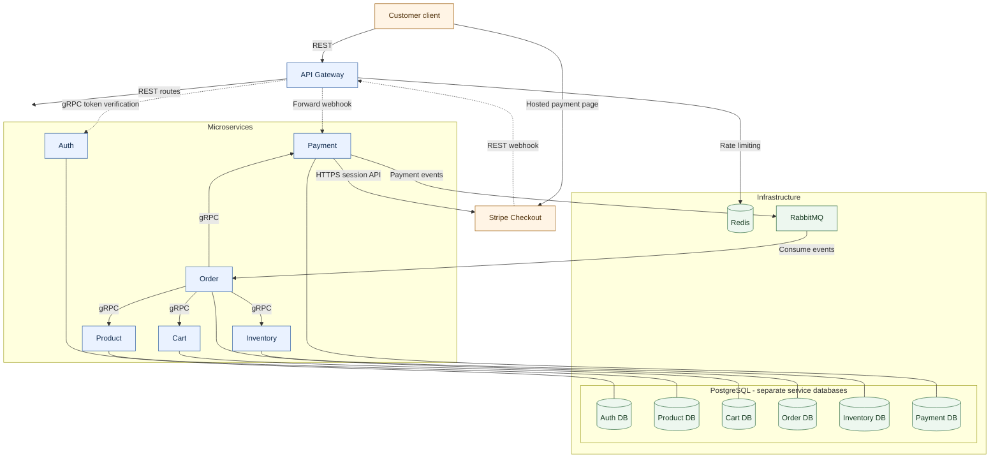

# E-commerce Backend

## Overview

A Go microservices project for authentication, product browsing, carts, checkout, stock reservations, and Stripe sandbox payments. Services follow hexagonal architecture, communicate through REST, gRPC, and RabbitMQ, and own their PostgreSQL databases.

## Architecture



*Figure 1. Logical microservices and infrastructure view.* Blue nodes are services, green nodes are infrastructure, and orange nodes are external participants. Lines to databases show ownership; arrow labels identify communication.

After confirmed payment, Order finalizes reserved stock, removes purchased cart quantities, and becomes `COMPLETED`. Saved state and idempotent operations allow interrupted work to resume.

## Run locally

Requires Go 1.26.3+, Docker Compose, and Stripe CLI for local payment webhooks. Run commands from this directory.

Start PostgreSQL, Redis, and RabbitMQ in Docker:

```bash
make infra-up
```

Set `JWT_SECRET` to a random value of at least 32 bytes in the Auth terminal. In the Payment terminal, set:

```bash
export STRIPE_SECRET_KEY='sk_test_REPLACE_ME'
export STRIPE_WEBHOOK_SECRET='whsec_REPLACE_ME'
export PAYMENT_SUCCESS_URL='http://localhost:5173/checkout/success'
export PAYMENT_CANCEL_URL='http://localhost:5173/cart'
```

Use your frontend's actual browser return URLs. Start each service in a **separate terminal**, with its required variables exported there:

```bash
./run-service.sh auth-service
./run-service.sh product-service
./run-service.sh cart-service
./run-service.sh inventory-service
./run-service.sh payment-service
./run-service.sh order-service
./run-service.sh api-gateway
```

The runner supplies local connection defaults. Services apply their migrations at startup. The gateway is available at `http://localhost:8080`.

## API

Import [the OpenAPI specification](api/openapi.yaml) into Postman. Customer requests use a Bearer token; checkout also requires an `Idempotency-Key`. Reuse the same key to retrieve the same order's progress.

For local Stripe sandbox payments, authenticate Stripe CLI to the same sandbox as your API key and keep this listener running:

```bash
stripe login
stripe listen --forward-to localhost:8080/api/v1/webhooks/stripe
```

Use the listener's `whsec_...` value as `STRIPE_WEBHOOK_SECRET` before starting Payment. Checkout returns a hosted payment URL; Stripe sends the result to the webhook, and Payment publishes it through RabbitMQ to Order. See [Stripe's sandbox card details](https://docs.stripe.com/testing) for manual payment verification.
